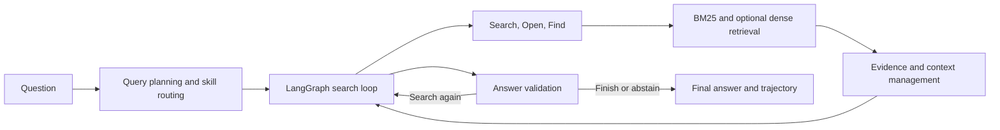
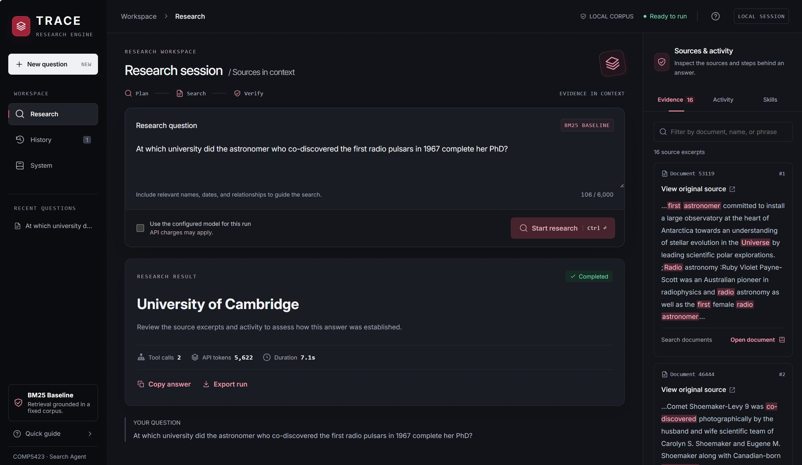

# Skill-Augmented Search Agent

A LangGraph research agent for multi-hop question answering over the fixed BrowseComp-Plus document collection. It plans search queries, inspects relevant passages, and checks candidate answers against recorded evidence. Its web workbench exposes sources, tool activity, loaded skills, and run metrics.

**[Technical Report (PDF)](Technical_Report.pdf)** · [Reproduction guide](docs/reproduction.md) · [Evaluation notes](docs/evaluation.md)

## How it works



- The query planner produces complementary searches. A runtime router loads skills for multi-hop search, entity disambiguation, or search recovery as needed.
- The agent uses one search tool plus document opening and passage lookup. It tracks document IDs, evidence offsets, visited documents, and unresolved facts across turns.
- The agent selects and compacts evidence for subsequent turns. A heuristic validator checks candidate answers before finalization. It may return `Unknown` when evidence is insufficient.
- The Vue workbench displays the answer, evidence, selected skills, and tool activity. The evaluator records trajectories, exact match, issued tool calls, and provider-reported tokens.



## Retrieval modes

| Mode | Document rankings |
| --- | --- |
| `bm25` (default) | SQLite FTS5 BM25 with query variants and rare-term search |
| `bm25_bge` | BM25 and FAISS with BAAI/bge-small-en-v1.5 |
| `bm25_qwen` | BM25 and FAISS with instruction-aware Qwen3-Embedding-0.6B |
| `bm25_bge_qwen` | All three rankings |

Dense retrievers rank passages and deduplicate by document ID. Reciprocal rank fusion combines document ranks from each branch, with a default constant of 60. BM25+BGE supports configurable weights. The Qwen modes use equal weights. Select the mode at startup with `RETRIEVAL_MODE`.

## Quick start

Use Python 3.12 or a compatible 3.13 installation with SQLite FTS5. To build the web frontend, install Node.js 22.12 or newer. The commands below use Windows PowerShell from the repository root.

```powershell
py -3.12 -m venv .venv
$python = '.\.venv\Scripts\python.exe'
& $python -m pip install -r requirements.txt
Copy-Item .env.example .env
& $python scripts/prepare_corpus.py
& $python retrieval/build_bm25_full.py
& $python scripts/build_doc_locator.py
```

The corpus contains 100,195 documents with `docid`, `text`, and `url`. The preparation script saves a Hugging Face Dataset under `data/corpus/`. Both the corpus and the SQLite index take several gigabytes. Configure your DeepSeek key locally in `.env` as `LLM_API_KEY` or supply it through your environment. Live questions use the provider API.

```powershell
$env:RETRIEVAL_MODE = 'bm25'
& $python main.py
```

For the web workbench, build the frontend once and start the Python server. Open [localhost:4173](http://127.0.0.1:4173).

```powershell
Push-Location frontend
npm ci
npm run build
Pop-Location
& $python web_server.py --host 127.0.0.1 --port 4173
```

See the [reproduction guide](docs/reproduction.md) for optional BGE/Qwen assets, model revisions, index compatibility, and troubleshooting. Restart the CLI or server after selecting a different mode.

## Evaluation

The evaluator accepts a local JSONL question set with `id`, `question`, and an optional `answer`. Use `--plan-only` to inspect selection offline. Live evaluation requires `--confirm-paid-run`. Repository EM applies Unicode normalization and replaces punctuation with spaces. Course-style punctuation deletion was tracked separately in the paired analysis.

| Study | Scope | Observation |
| --- | --- | --- |
| Historical BM25 validation | 94 scored questions of 100 planned | 40 correct, 42.55% repository normalized EM |
| Paired configuration ablation | 13 jointly completed validation questions | Full baseline 6/13, no planner 5/13, no thinking 3/13, Top-K 4 at 6/13 |
| Exploratory retrieval comparison | 4 jointly completed validation questions | BM25 4/4, BM25+BGE 1/4, BM25+Qwen 2/4, three-way 2/4 |

The historical score is a reported result from the upstream baseline. The small comparisons describe the completed samples. The [technical report](Technical_Report.pdf) gives methodology, case examples, and limitations.

## Repository layout

| Path | Contents |
| --- | --- |
| `agent/`, `skills/` | Controller, planning, prompting, evidence, and runtime skills |
| `retrieval/`, `tools/` | Ranking, index adapters, and document inspection |
| `evaluation/`, `scripts/` | Scoring, evaluation, and local data preparation |
| `frontend/`, `web_server.py` | Vue/TypeScript workbench and Python HTTP server |
| `tests/`, `docs/` | Offline tests and technical documentation |

```powershell
& $python -m pytest -q
```

## Limits and provenance

The agent searches a fixed corpus and depends on an external LLM for planning and decision-making. Results can vary across provider versions and runs. Hybrid modes require locally prepared encoder weights and indexes. The workbench is intended for local research and demonstration.

The project builds on the [upstream Gitee course project](https://gitee.com/zeng-qijie13/nlp-project) at commit `cd7818cc6e5dda5d077f96904c3d4cfe90c799cd` with local BGE and Qwen extensions. It uses [LangGraph](https://github.com/langchain-ai/langgraph), [BrowseComp-Plus](https://huggingface.co/datasets/Tevatron/browsecomp-plus-corpus), [FAISS](https://github.com/facebookresearch/faiss), [BGE](https://huggingface.co/BAAI/bge-small-en-v1.5), and [Qwen3-Embedding](https://huggingface.co/Qwen/Qwen3-Embedding-0.6B). See [provenance and licensing](docs/provenance.md) for rights and attribution.
