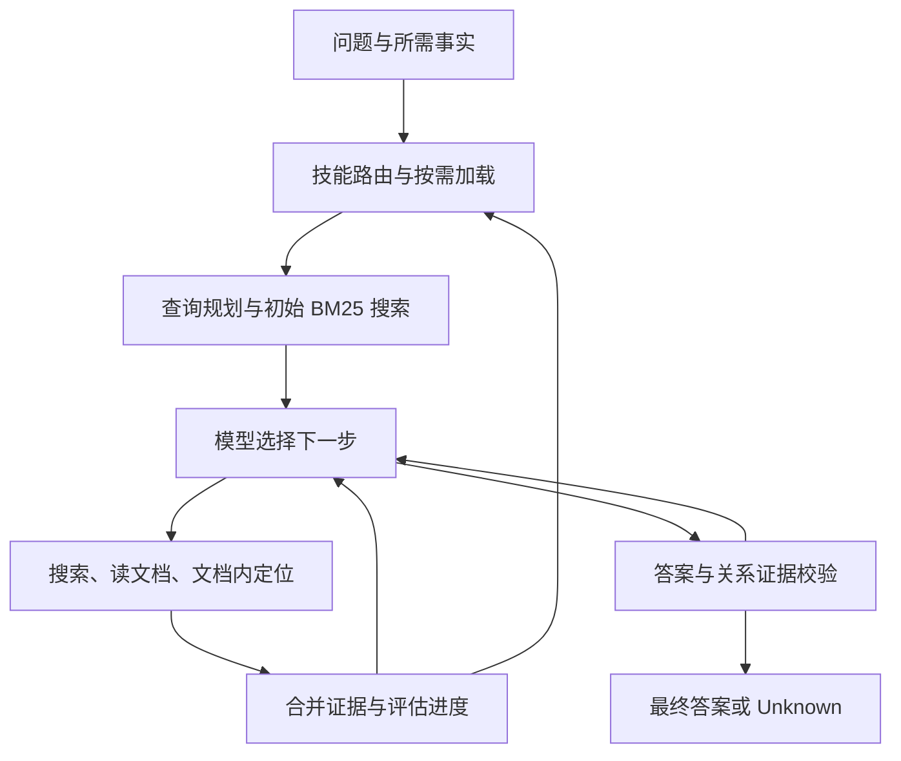

# BM25 baseline 架构

This document describes the original BM25 workflow. Optional dense branches enter through the same search tool. See the [retrieval modes](../README.md#retrieval-modes).

系统在固定 BrowseComp-Plus 文档集合中寻找证据，用 DeepSeek 和 LangGraph 完成多轮检索问答。检索、证据处理与技能路由均围绕同一套 BM25 实现。

## 搜索流程

图示表达主要流程；预算、查询去重和剩余规划查询决定具体路由。模型不直接访问互联网，文档中的 URL 是来源元数据。

## 检索与工具

`retrieval/bm25_full_retriever.py` 读取 SQLite FTS5 全量索引。索引使用 `porter unicode61` 分词；短查询生成实体短语、严格组合和宽松组合，各变体按候选池深度检索，再以 `sum(1 / (60 + rank))` 进行 RRF 融合。原词序视角和按语料稀有度排序的视角分别排名，再交错去重。

长查询会从整个问题中查找实际入库的词，优先选择至多 12 个稀有词检索；结果不足时由双视角检索补足。该逻辑属于本 baseline 的检索路径。Top‑8 是工具默认返回量，Agent 可在工具 schema 允许的 1–20 范围内显式调整深度。

| 工具 | 用途 | 主要返回内容 |
| --- | --- | --- |
| `search_documents` | BM25 检索相关文档 | docid、排名、融合分数、命中摘要、URL |
| `open_document` | 按字符偏移分页读取 | 正文片段、起止位置、下一页位置 |
| `find_in_document` | 文档内关键词定位 | 匹配位置、周边片段、下一次定位位置 |

每次搜索独立打开只读 SQLite 连接。临时词频表位于连接的临时数据库，不修改原始索引，批量评测可并发运行。

## 规划、状态和上下文

查询规划器先生成互补的关键词查询；输出无效或请求失败时回退到确定性的线索拆分。规划器用量计入总 Token。主流程保留原始问题、消息、完整轨迹、候选实体、所需事实、搜索进度及延迟执行的查询。

证据带有稳定 ID、docid、来源工具、查询、分数及字符偏移。存储最多 60 条，每条最多 2,000 字符；合并时去重，并优先保留支持已知事实的证据与文档阅读结果。

组装提示时不重复附加成功工具输出，而是从证据状态选择内容。搜索摘要最多 350 字符，文档阅读证据最多 900 字符，并保留支持事实的内容。完整轨迹仍单独保存，提示精简不会删除审计轨迹。

## 技能和停止条件

技能首先按问题结构路由，再按需读取 `SKILL.md`：

- `multi-hop-search`：跨线索拆解和多跳证据连接。
- `entity-disambiguation`：同名或相似实体区分。
- `search-recovery`：失败、近重复搜索或无有效进展后的查询调整。

搜索进度综合新增证据、事实覆盖、重复查询、结果重合与候选实体。候选得到独立文档支持后可转入规范答案生成；连续 3 轮无有效进展后停止继续泛搜，并尝试一次基于现有证据的最终综合。10 个 Agent 步骤、15 次工具调用及单题 Token 软阈值共同约束运行。

最终答案经过类型、所需事实和关系校验。线索中的中间实体不会直接视为目标答案；证据不足时输出 `Unknown`。正常搜索中的证据充分停止仍然保留。

## 界面与审计

`frontend/` 使用 Vue 3、TypeScript 和 Vite。组件负责呈现，`services/api.ts` 封装接口，`composables/useWorkbench.ts` 管理运行状态和浏览器会话记录；API 类型和展示文案分别维护，避免页面与请求实现混杂。

`web_server.py` 托管 `frontend/dist/`，提供健康检查、问答和按字符偏移分页的文档读取接口。健康检查只读验证索引结构，返回实际文档数与当前配置，不暴露密钥。尚未构建前端时返回明确的 503 提示。页面呈现最终答案、证据、技能和工具过程；运行中不伪造实时步骤或证据。

工具结果和轨迹通过文本节点安全显示，来源链接仅允许 HTTP/HTTPS。模型调用需要显式确认，前后端均限制问题长度，前端运行状态与服务端锁共同避免重复执行。浏览器记录只保留在当前会话，最多十条；原始运行生成文件仍位于被 Git 忽略的 `output/`。

`agent/hooks.py` 支持控制台观测；`agent/efficiency.py` 汇总 API 用量、调用和无进展轮次。前端改造不修改 BM25 检索排序、提示词、Agent 决策与基线参数。
